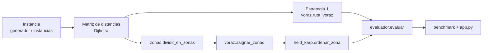

# Ruta Óptima de Última Milla — Lima

Optimización de rutas de reparto de última milla en Lima con **capacidad de vehículo, ventanas de tiempo y jornada máxima** (problema tipo VRPTW, NP-difícil).
Curso: *Análisis de Algoritmos y Estrategias de Programación* — UPN, Ingeniería de Sistemas.

Se comparan dos estrategias sobre las mismas instancias:

| | Estrategia 1: **Voraz** | Estrategia 2: **Divide y vencerás + PD** |
|---|---|---|
| Idea | Vecino más cercano, un vehículo a la vez | Zonas (Quickselect) → reparto voraz de zonas a vehículos → orden óptimo dentro de cada zona (Held-Karp) |
| Complejidad | O(n²) | O(n log n) + O((n/k)·k²·2^k) |
| Camino mínimo | Dijkstra sobre una red de calles simulada (común a ambas) | idem |



## Cómo ejecutarlo (5 minutos) → ver [EJECUTAR.md](EJECUTAR.md)

```bash
python -m pip install -r requirements.txt
python app.py            # abre la página web en http://localhost:8000
```
En Windows también: doble clic en `ejecutar.bat`.

Otros comandos: `python main.py --n 60 --vehiculos 9` (consola) · `python -m pytest` (pruebas) · `python main.py --estado` (tablero).

## Tablero del equipo: ¿qué falta?

**El código ya está terminado y probado.** Cada integrante tiene una tarea corta (30–45 min): ejecutar su parte, guardar la evidencia, responder 3 preguntas y subirlo por Pull Request.
**Cada uno edita SOLO su fila** (nombre y estado) dentro de su Pull Request.

| Rol | Tarea | Parte del código | Rama | Guía | Responsable | Estado |
|---|---|---|---|---|---|---|
| 1 | Base del proyecto, evaluador, solver, pruebas, CI y página | `ruta_optima/` base | `main` | [EJECUTAR](EJECUTAR.md) | Luis Angel López Siccha | ✅ Listo |
| 2 | Instancias: guardar/cargar y distritos | `ruta_optima/instancias.py` | `feature/rol02-instancias` | [ROL-02](docs/tareas/ROL-02_instancias.md) | Edgar Ismael Victorio Capa | ⬜ Pendiente |
| 3 | Distancias: Dijkstra y red de calles | `ruta_optima/distancias.py` | `feature/rol03-distancias` | [ROL-03](docs/tareas/ROL-03_distancias.md) | Reyes Casiano Luis Fernando | ⬜ Pendiente |
| 4 | Zonas: divide y vencerás (Quickselect) | `ruta_optima/zonas.py` | `feature/rol04-zonas` | [ROL-04](docs/tareas/ROL-04_zonas.md) | _(nombre)_ | ⬜ Pendiente |
| 5 | Voraz y reparto de zonas | `ruta_optima/voraz.py` | `feature/rol05-voraz` | [ROL-05](docs/tareas/ROL-05_voraz.md) | _(Carlo Stefano Soel Olivo)_ | ⬜ Pendiente |
| 6 | Programación dinámica Held-Karp | `ruta_optima/held_karp.py` | `feature/rol06-held-karp` | [ROL-06](docs/tareas/ROL-06_held-karp.md) | _(nombre)_ | ⬜ Pendiente |
| 7 | Fuerza bruta de verificación | `ruta_optima/fuerza_bruta.py` | `feature/rol07-fuerza-bruta` | [ROL-07](docs/tareas/ROL-07_fuerza-bruta.md) | _(nombre)_ | ⬜ Pendiente |
| 8 | Benchmark, gráficos y casos extremos | `ruta_optima/benchmark.py`, `tests/test_casos_borde.py` | `feature/rol08-benchmark-pruebas` | [ROL-08](docs/tareas/ROL-08_benchmark-pruebas.md) | _(nombre)_ | ⬜ Pendiente |
| 9 | Página web, demo y capturas | `app.py`, `web/` | `feature/rol09-interfaz-web` | [ROL-09](docs/tareas/ROL-09_interfaz-web.md) | _(Christian Valer)_ | ⬜ Pendiente |
| 10 | Informe final y sustentación | `docs/PRESENTACION.md` + informe Word | `feature/rol10-informe-y-sustentacion` | [ROL-10](docs/tareas/ROL-10_informe-y-sustentacion.md) | _(nombre)_ | ⬜ Pendiente |

Estados: ⬜ Pendiente · 🟨 En curso · ✅ Listo

## Flujo de trabajo (resumen)

1. Cada rol trabaja en **su propia rama** (`feature/rolNN-...`) y sube **sus propios archivos**: así no hay conflictos.
2. Cuando termina y sus pruebas pasan: `git push` y un **Pull Request** hacia `main`.
3. Un compañero lo revisa, GitHub Actions corre las pruebas y se hace **Merge** a `main`.
4. Antes de empezar a trabajar cada día: `git pull origin main` para traer lo que ya terminaron los demás.

Detalle paso a paso (con comandos): **[docs/GUIA_GIT.md](docs/GUIA_GIT.md)**.
Contratos, unidades y cómo se conectan los módulos: **[docs/ARQUITECTURA.md](docs/ARQUITECTURA.md)**.

## Estructura

```
ruta-optima-ultima-milla/
├── main.py                  # consola: --estado, comparar estrategias
├── app.py                   # servidor de la página web
├── web/                     # página: index.html, estilos.css, app.js
├── scripts/                 # un script de evidencia por rol + crear_ramas
├── EJECUTAR.md              # cómo ejecutar
├── ruta_optima/
│   ├── config.py            # TODOS los parámetros (Tabla 1 del informe)
│   ├── modelos.py           # Cliente, Instancia, Solucion
│   ├── generador.py         # instancias aleatorias reproducibles
│   ├── utilidades.py        # distancias aproximadas, horas
│   ├── evaluador.py         # fuente única de verdad: factibilidad y costo
│   ├── solver.py            # junta las dos estrategias
│   ├── estado.py            # tablero automático
│   ├── instancias.py        # ROL 2 (todos los módulos ya están programados)
│   ├── distancias.py        # ROL 3
│   ├── zonas.py             # ROL 4
│   ├── voraz.py             # ROL 5
│   ├── held_karp.py         # ROL 6
│   ├── fuerza_bruta.py      # ROL 7
│   └── benchmark.py         # ROL 8
├── tests/                   # pruebas de aceptación (se saltan mientras el módulo está pendiente)
├── docs/                    # guías por rol, git, arquitectura y guion de presentación
├── resultados/              # CSV y gráficos del benchmark
└── .github/                 # CI (GitHub Actions) y plantilla de Pull Request
```

## Resultados

Tabla y gráficos en [docs/RESULTADOS.md](docs/RESULTADOS.md) y `resultados/`. Guion de la sustentación: [docs/PRESENTACION.md](docs/PRESENTACION.md).

## Equipo

_(Completar con los nombres de los 10 integrantes.)_
